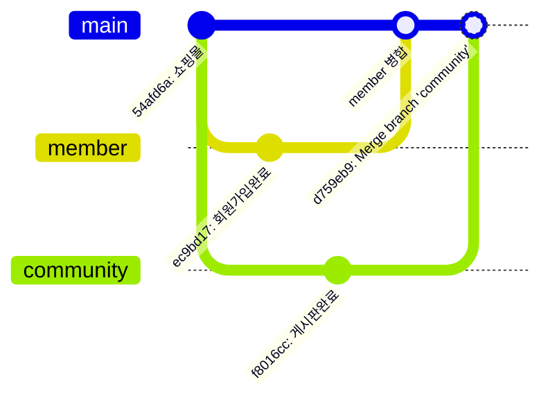

# 🛒 Shop - Git 브랜치 협업 시나리오 가이드

> **팀장과 두 명의 신입 개발자가 함께 만드는 쇼핑몰 프로젝트**  
> Git의 핵심 기능인 **브랜치(Branch)** 와 **병합(Merge)** 을 실무 협업 시나리오를 통해 쉽고 자세하게 배우는 가이드 문서입니다.

---

## 📌 목차
1. [시나리오 개요](#-시나리오-개요)
2. [역할 분담 및 브랜치 구조](#-역할-분담-및-브랜치-구조)
3. [Git 브랜치 흐름도 (Git Graph)](#-git-브랜치-흐름도-git-graph)
4. [단계별 실습 가이드 (명령어 포함)](#-단계별-실습-가이드)
5. [실제 커밋 히스토리 확인](#-실제-커밋-히스토리-확인)
6. [핵심 개념 Q&A (왜 충돌이 안 났을까?)](#-핵심-개념-qa)

---

## 📖 1. 시나리오 개요

쇼핑몰 웹사이트(`shop`) 개발을 시작합니다.  
팀장(선임 개발자)은 프로젝트의 뼈대를 만들고, 두 명의 신입 개발자에게 각각 독립된 기능을 맡깁니다.

* **팀장 (선임 개발자)**: 메인 프로젝트 초기화 및 최종 코드 병합 총괄
* **신입 개발자 A**: 회원 관리 담당 ➔ **`member` 브랜치**에서 `회원가입 기능` 개발
* **신입 개발자 B**: 커뮤니티 담당 ➔ **`community` 브랜치**에서 `게시판 기능` 개발

> [!NOTE]  
> **왜 브랜치(Branch)를 나눌까요?**  
> 개발자 A와 B가 메인(`main`) 코드에서 동시에 직접 작업하면 코드가 꼬이거나 미완성 코드가 배포될 위험이 있습니다.  
> 브랜치를 나누면 **각자 독립된 복사본 작업실**에서 마음 편히 개발하고, 완료된 것만 검토 후 합칠 수 있습니다.

---

## 👥 2. 역할 분담 및 브랜치 구조

| 역할 | 담당 브랜치 | 작업 내용 | 생성 파일 |
| :--- | :--- | :--- | :--- |
| **팀장 (선임)** | `main` | 기본 프로젝트 세팅 & 최종 병합 | `index.html` |
| **신입 개발자 A** | `member` | 회원가입 기능 개발 | `member/member.html` |
| **신입 개발자 B** | `community` | 게시판 기능 개발 | `community/community.html` |

---

## 🌲 3. Git 브랜치 흐름도 (Git Graph)



1. `main` 브랜치에서 첫 커밋 `54afd6a 쇼핑몰` 생성
2. `member`, `community` 브랜치가 각각 분기되어 서로 영향을 주지 않고 병렬 개발 진행
3. 개발이 완료된 순서대로 `main` 브랜치에 안전하게 병합(Merge)

---

## 🛠️ 4. 단계별 실습 가이드

### STEP 1. [팀장] 메인 프로젝트 초기화
팀장이 쇼핑몰 프로젝트 기본 골격을 만들고 첫 번째 커밋을 남깁니다.

```bash
# 1. shop 폴더 생성 및 이동 (이미 생성된 경우 생략)
cd shop

# 2. Git 저장소 초기화
git init

# 3. 기본 메인 페이지 생성
touch index.html

# 4. 첫 커밋 생성
git add index.html
git commit -m "쇼핑몰"
```

---

### STEP 2. [신입 개발자 A] 회원가입 기능 개발 (`member` 브랜치)
신입 A는 `member` 브랜치로 이동하여 회원가입 관련 작업을 진행합니다.

```bash
# 1. member 브랜치 생성 및 이동
git branch member
git checkout member
# (최신 Git에서는 한 줄로 가능: git switch -c member)

# 2. 회원 폴더 및 회원가입 파일 생성
mkdir member
touch member/member.html

# 3. 작업 내용 커밋
git add member/member.html
git commit -m "회원가입완료"
```

---

### STEP 3. [신입 개발자 B] 게시판 기능 개발 (`community` 브랜치)
신입 B는 메인 코드를 기준으로 `community` 브랜치를 따서 게시판 기능을 개발합니다.

```bash
# 1. 메인 브랜치로 돌아온 후 community 브랜치 생성 및 이동
git checkout main
git branch community
git checkout community
# (최신 Git에서는 한 줄로 가능: git switch -c community)

# 2. 게시판 폴더 및 게시판 파일 생성
mkdir community
touch community/community.html

# 3. 작업 내용 커밋
git add community/community.html
git commit -m "게시판완료"
```

---

### STEP 4. [팀장] 기능 검토 후 `main` 브랜치에 병합 (Merge)
두 신입 개발자의 기능 개발이 끝났으므로, 팀장이 메인 코드에 순서대로 합칩니다.

```bash
# 1. 기준이 될 main 브랜치로 이동
git checkout main

# 2. 먼저 완료된 개발자 A의 회원가입 기능 병합
git merge member

# 3. 이어서 개발자 B의 게시판 기능 병합
git merge community
# (Merge Commit 메시지 입력 창이 뜨면 저장 후 종료)
```

---

## 🔍 5. 실제 커밋 히스토리 확인

터미널에서 아래 명령어를 실행하면 실제 브랜치가 나뉘었다가 하나로 합쳐진 트리를 시각적으로 확인할 수 있습니다.

```bash
git log --all --graph --oneline --decorate
```

### 실제 출력 결과
```text
*   d759eb9 (HEAD -> main) Merge branch 'community'
|\  
| * f8016cc (community) 게시판완료
* | ec9bd17 (member) 회원가입완료
|/  
* 54afd6a 쇼핑몰
```

* `54afd6a`: 팀장이 처음 만든 메인 프로젝트 커밋
* `ec9bd17`: 개발자 A가 `member` 브랜치에서 작업한 커밋
* `f8016cc`: 개발자 B가 `community` 브랜치에서 작업한 커밋
* `d759eb9`: 두 기능이 모두 합쳐진 최종 메인 커밋 (Merge Commit)

---

## 💡 6. 핵심 개념 Q&A

### Q1. 두 개발자가 동시에 작업해서 합쳤는데 왜 충돌(Conflict)이 나지 않았나요?
> **A.** 서로 **완전히 다른 파일과 폴더**(`member/member.html` vs `community/community.html`)를 작업했기 때문입니다.  
> Git은 서로 다른 파일이나 다른 줄의 수정 사항은 자동으로 안전하게 합쳐줍니다.

### Q2. 만약 둘 다 `index.html`의 같은 줄을 수정했다면 어떻게 되나요?
> **A.** Git이 둘 중 어떤 코드가 맞는지 판단할 수 없어서 **충돌(Conflict)** 이 발생합니다.  
> 이때는 팀장이나 담당 개발자가 상의하여 남길 코드를 직접 선택하고 다시 커밋하면 해결됩니다.

### Q3. 기능 개발이 끝난 브랜치는 어떻게 하나요?
> **A.** 메인에 성공적으로 병합된 브랜치는 보관하거나, 정리 차원에서 삭제할 수 있습니다:
> ```bash
> git branch -d member
> git branch -d community
> ```

---

## 📁 7. 최종 프로젝트 파일 구조

```text
shop/
├── .git/                      # Git 형상관리 폴더
├── index.html                 # [팀장] 쇼핑몰 메인 페이지
├── member/
│   └── member.html            # [신입 A] 회원가입 페이지
├── community/
│   └── community.html         # [신입 B] 게시판 페이지
├── branch개념잡기.mp4           # 🎬 브랜치 실습 영상 (참고용)
└── README.md                  # 📄 프로젝트 설명서 (현재 파일)
```

---
*Created by Team Lead & Juniors (Project Shop)*
